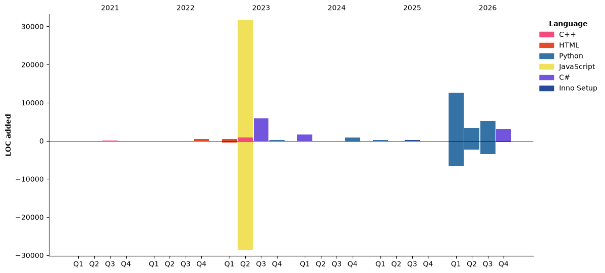

## 谁问你了？

[](https://git.io/typing-svg)



<!--START_SECTION:waka-->


**🐱 我的 GitHub 数据** 

> 📦  使用了 215.1 kB GitHub 存储空间 
 > 
> 🏆 201 个贡献，在 2026 年
 > 
> 🚫 不开放招聘
 > 
> 📜 23 个公共仓库 
 > 
> 🔑 13 个私人仓库 
 > 
**我是夜猫 🦉** 

```text
🌞 早晨                     106 commits         ███░░░░░░░░░░░░░░░░░░░░░░   11.43 % 
🌆 白天                     303 commits         ████████░░░░░░░░░░░░░░░░░   32.69 % 
🌃 傍晚                     509 commits         ██████████████░░░░░░░░░░░   54.91 % 
🌙 晚上                     9 commits           ░░░░░░░░░░░░░░░░░░░░░░░░░   00.97 % 
```
📅 **星期日 时的我最有干劲** 

```text
星期一                      102 commits         ███░░░░░░░░░░░░░░░░░░░░░░   11.00 % 
星期二                      181 commits         █████░░░░░░░░░░░░░░░░░░░░   19.53 % 
星期三                      58 commits          ██░░░░░░░░░░░░░░░░░░░░░░░   06.26 % 
星期四                      25 commits          █░░░░░░░░░░░░░░░░░░░░░░░░   02.70 % 
星期五                      36 commits          █░░░░░░░░░░░░░░░░░░░░░░░░   03.88 % 
星期六                      194 commits         █████░░░░░░░░░░░░░░░░░░░░   20.93 % 
星期日                      331 commits         █████████░░░░░░░░░░░░░░░░   35.71 % 
```


📊 **本周消耗时间** 

```text
🕑︎ 时区: Asia/Shanghai

💬 编程语言: 
C#                       14 mins             █████████░░░░░░░░░░░░░░░░   34.11 % 
Other                    11 mins             ███████░░░░░░░░░░░░░░░░░░   27.28 % 
Binary                   6 mins              ████░░░░░░░░░░░░░░░░░░░░░   15.84 % 
XML                      4 mins              ███░░░░░░░░░░░░░░░░░░░░░░   11.72 % 
Microsoft Visual Studio S4 mins              ███░░░░░░░░░░░░░░░░░░░░░░   11.05 % 

🔥 编辑器: 
Visual Studio            18 mins             ███████████░░░░░░░░░░░░░░   42.65 % 
Opencode Cli             11 mins             ███████░░░░░░░░░░░░░░░░░░   26.20 % 
OpenCode                 10 mins             ██████░░░░░░░░░░░░░░░░░░░   24.35 % 
VS Code                  2 mins              ██░░░░░░░░░░░░░░░░░░░░░░░   06.81 % 

💻 操作系统: 
Windows                  42 mins             █████████████████████████   100.00 % 
```

🤖 **AI Coding This Week** 

```text
⏱ AI Coding Time: 37 mins (89.27%)

✍️ 223 lines written by AI, 122 lines written by hand (64.64% AI-written)

🔤 2,036,905 Input Tokens, 59,238 Output Tokens

💵 $20.64 Estimated AI Cost This Week

🧠 3 AI Sessions, 11 AI Prompts

DeepSeek                 0 lines             ░░░░░░░░░░░░░░░░░░░░░░░░░   00.00 % 
Visualstudio             0 lines             ░░░░░░░░░░░░░░░░░░░░░░░░░   00.00 % 

🔎 AI Coding Insights:
⚖️ Balanced with AI — 64.64% of written lines came from AI
📝 Concise Prompter — average 32 characters per prompt
🔁 Iterative Prompter — average 4 prompts per session
🚀 High AI Trust — 35.06% of changed lines were hand-edited
```

**我最常使用 Python** 

```text
Python                   26 repos            █████████████░░░░░░░░░░░░   53.06 % 
C#                       7 repos             ████░░░░░░░░░░░░░░░░░░░░░   14.29 % 
JavaScript               2 repos             █░░░░░░░░░░░░░░░░░░░░░░░░   04.08 % 
HTML                     2 repos             █░░░░░░░░░░░░░░░░░░░░░░░░   04.08 % 
Inno Setup               1 repo              █░░░░░░░░░░░░░░░░░░░░░░░░   02.04 % 
```


**时间线**




 Last Updated on 31/10/2026 21:52:22 UTC
<!--END_SECTION:waka-->
