## 谁问你了？

[](https://git.io/typing-svg)



<!--START_SECTION:waka-->


**🐱 我的 GitHub 数据** 

> 📦  使用了 214.9 kB GitHub 存储空间 
 > 
> 🏆 195 个贡献，在 2026 年
 > 
> 🚫 不开放招聘
 > 
> 📜 23 个公共仓库 
 > 
> 🔑 13 个私人仓库 
 > 
**我是夜猫 🦉** 

```text
🌞 早晨                     93 commits          ███░░░░░░░░░░░░░░░░░░░░░░   10.97 % 
🌆 白天                     279 commits         ████████░░░░░░░░░░░░░░░░░   32.90 % 
🌃 傍晚                     467 commits         ██████████████░░░░░░░░░░░   55.07 % 
🌙 晚上                     9 commits           ░░░░░░░░░░░░░░░░░░░░░░░░░   01.06 % 
```
📅 **星期日 时的我最有干劲** 

```text
星期一                      89 commits          ███░░░░░░░░░░░░░░░░░░░░░░   10.50 % 
星期二                      169 commits         █████░░░░░░░░░░░░░░░░░░░░   19.93 % 
星期三                      55 commits          ██░░░░░░░░░░░░░░░░░░░░░░░   06.49 % 
星期四                      25 commits          █░░░░░░░░░░░░░░░░░░░░░░░░   02.95 % 
星期五                      35 commits          █░░░░░░░░░░░░░░░░░░░░░░░░   04.13 % 
星期六                      180 commits         █████░░░░░░░░░░░░░░░░░░░░   21.23 % 
星期日                      295 commits         █████████░░░░░░░░░░░░░░░░   34.79 % 
```


📊 **本周消耗时间** 

```text
🕑︎ 时区: Asia/Shanghai

💬 编程语言: 
本周没有记录到任何活动

🔥 编辑器: 
本周没有记录到任何活动

💻 操作系统: 
本周没有记录到任何活动
```

🤖 **AI Coding This Week** 

```text
No AI Coding Activity Tracked This Week
```

**我最常使用 Python** 

```text
Python                   25 repos            █████████████░░░░░░░░░░░░   52.08 % 
C#                       7 repos             ████░░░░░░░░░░░░░░░░░░░░░   14.58 % 
JavaScript               2 repos             █░░░░░░░░░░░░░░░░░░░░░░░░   04.17 % 
HTML                     2 repos             █░░░░░░░░░░░░░░░░░░░░░░░░   04.17 % 
Inno Setup               1 repo              █░░░░░░░░░░░░░░░░░░░░░░░░   02.08 % 
```


**时间线**


 Last Updated on 20/10/2026 21:52:26 UTC
<!--END_SECTION:waka-->
